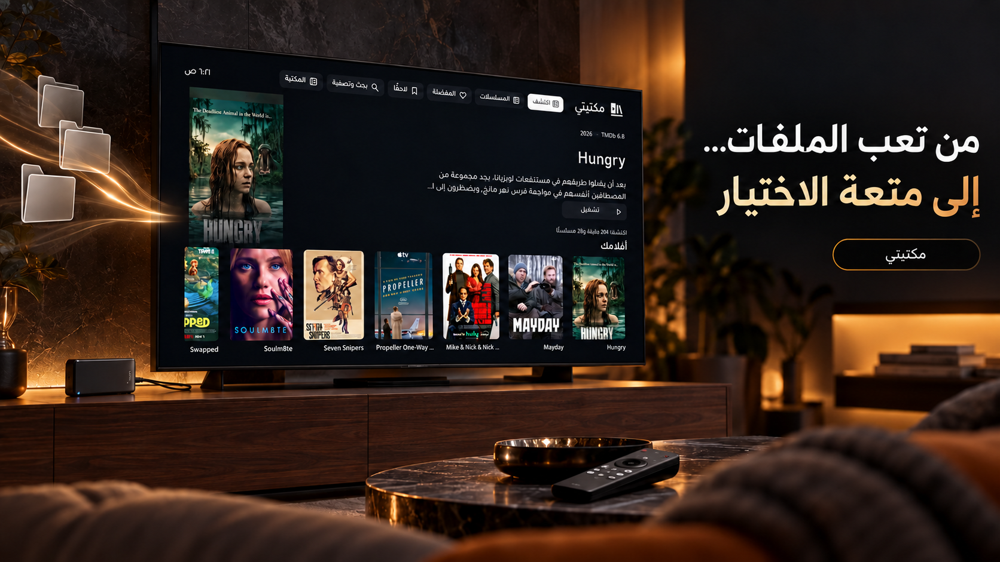
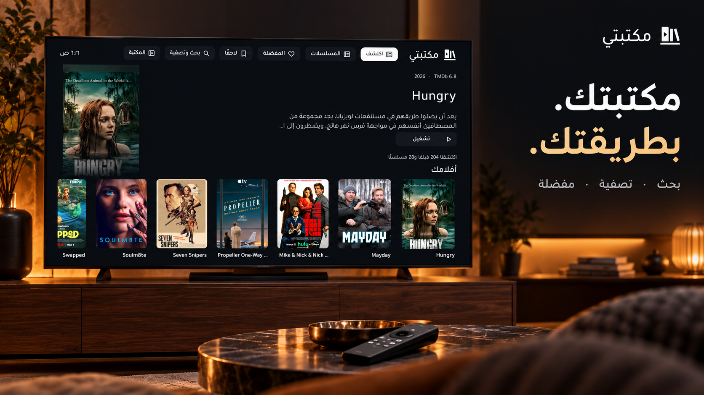
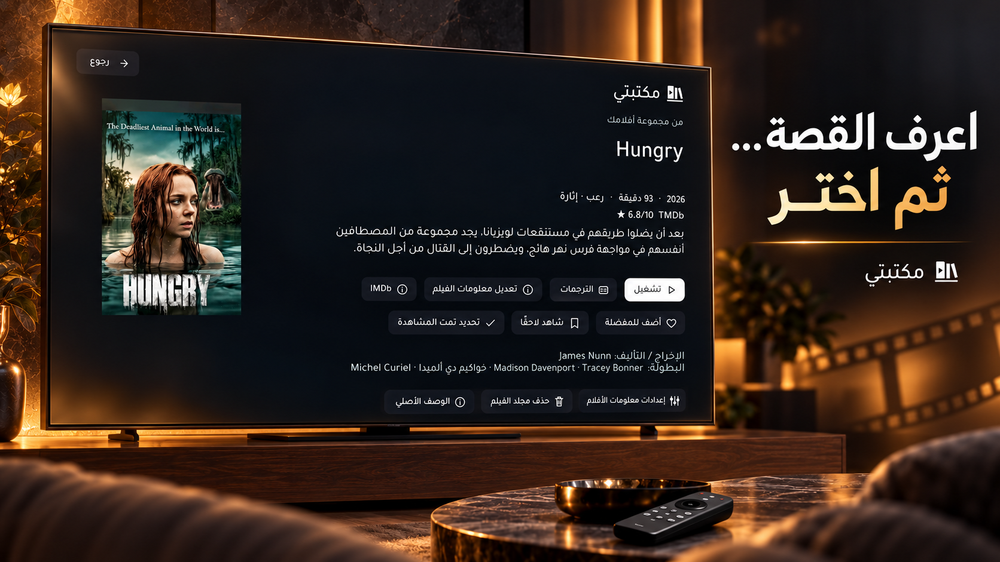
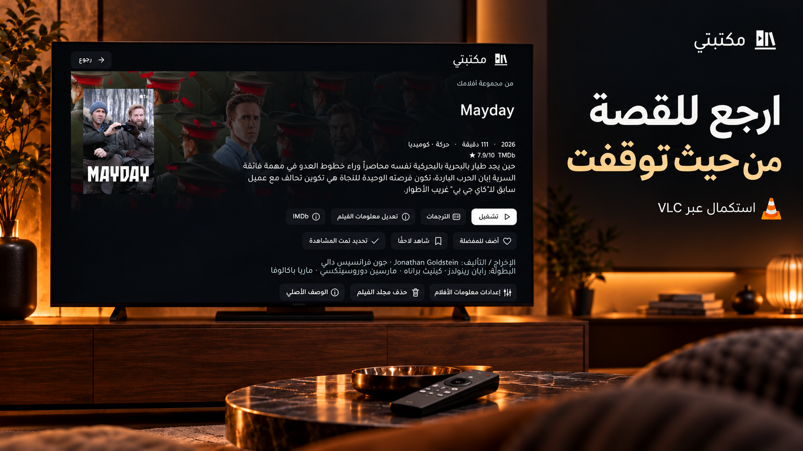
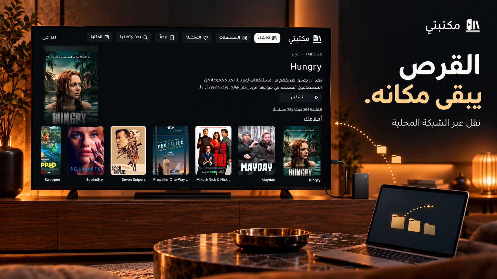
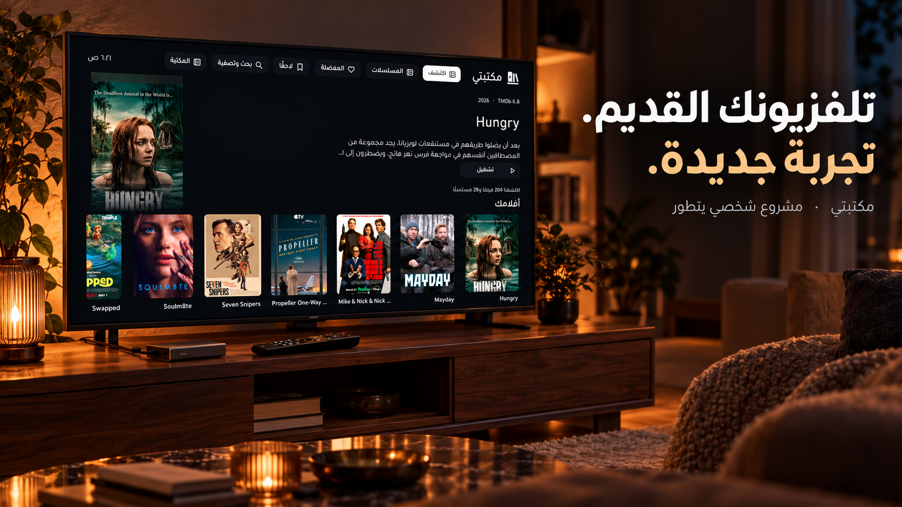

# مكتبتي · Maktabati TV

**من تعب الملفات… إلى متعة الاختيار.**

تجربة عربية لتنظيم وتصفح الأفلام والمسلسلات الشخصية على Android TV، مصممة للريموت وشاشة التلفزيون.

> **حالة المستودع:** معرض عام للفكرة والتجربة الحالية. لا يتضمن الكود المصدري أو APK للتثبيت حتى الآن. المزايا أدناه منفّذة في النسخة الشخصية التجريبية، وليست وعدًا بتوافق جميع الأجهزة.

## لماذا «مكتبتي»؟

بدأ المشروع من تجربة يومية متعبة: قرص متصل بالتلفزيون، أسماء ملفات طويلة، تنقل بين المجلدات بالريموت، ثم فصل القرص كلما أردت إضافة ملف جديد.

أردت أن تصبح البداية هي اختيار ما أشاهد، فطوّرت واجهة تعرض مكتبتي بأغلفتها وتفاصيلها، وتربط التنظيم بالتشغيل عبر VLC.

## ماذا يفعل؟

| الميزة | التجربة الحالية |
| --- | --- |
| تصفح الأفلام والمسلسلات | أغلفة وصفحات تفاصيل وواجهة عربية مناسبة للريموت |
| البحث والتنظيم | بحث بالاسم أو السنة، تصفية وفرز، مفضلة، ومشاهدة لاحقًا |
| بيانات الأعمال | ربط اختياري بـTMDb، مع تصحيح المطابقة يدويًا |
| الوصف العربي | تفضيل وصف TMDb العربي، وملخصات محلية لبعض الأعمال عند غيابه |
| متابعة المشاهدة | استقبال موضع المشاهدة عند العودة من VLC وعرض التقدم والاستكمال |
| فتح المكتبة | فهرس محفوظ يُحدّث في الخلفية |
| نقل الملفات | نقل عبر الشبكة المحلية إلى مجلد التطبيق المسموح بالكتابة فيه |
| حذف الملفات | حذف داخل النطاق الذي تسمح صلاحيات التخزين بالكتابة فيه |

التطبيق ينظم ملفات المستخدم الشخصية؛ لا يوفر أفلامًا أو اشتراكات أو روابط تنزيل.

## تجربة عربية على التلفزيون

الأزرار صغيرة وواضحة، بأيقونات أحادية اللون وحالة تركيز مميزة. وصف الفيلم بتباعد مريح بين الأسطر، مع إمكانية عرض الوصف الأصلي.

## تنظيم في «مكتبتي»، وتشغيل عبر VLC

يعتمد التشغيل على VLC؛ «مكتبتي» يضيف تجربة التصفح والتنظيم والاستكمال حوله، ولا يدّعي استبدال محرك تشغيله.

## القرص يبقى مكانه

نقل الملفات عبر الشبكة المحلية يقلل الحاجة إلى فصل القرص من التلفزيون. **الكتابة والحذف محدودان بالصلاحيات المتاحة**؛ في الجهاز الذي اختُبر عليه المشروع يعملان داخل مجلد التطبيق، وليس جميع مجلدات القرص القديمة.

احتفظ بنسخة أصلية: إزالة التطبيق قد تحذف مجلده الخاص وما نُقل إليه.

## التوافق والحدود

- طُوّرت التجربة واختُبرت على Android TV 9. يختلف دعم التخزين والريموت والتشغيل بين الأجهزة.
- يُفتح «مكتبتي» كتطبيق عادي؛ لا يستبدل HOME ولا يتطلب تعديل نظام التلفزيون.
- بيانات TMDb تحتاج رمز المستخدم واتصالًا بالإنترنت؛ قد تتطلب بعض العناوين تصحيح المطابقة يدويًا.
- الملخصات العربية المحلية ليست خدمة ترجمة شاملة لكل عنوان جديد.
- الاستكمال يعتمد على البيانات التي يعيدها VLC عند الرجوع إلى التطبيق.
- لا توجد حاليًا نسخة عامة للتثبيت أو تعليمات بناء؛ المستودع يعرض الفكرة فقط.

## الصور

الصور الست **تصاميم دعائية مولّدة بالذكاء الاصطناعي تستند إلى لقطات التطبيق الفعلي**. الغرفة والإضاءة والتكوين إبداعية، وقد تُعاد صياغة تفاصيل دقيقة داخل الشاشة؛ ليست تسجيلًا حرفيًا لكل بكسل من الواجهة.

[معرض الصور](docs/GALLERY.md) · [الأسئلة الشائعة](docs/FAQ.md) · [أفكار التطوير](docs/ROADMAP.md)

## شارك رأيك

ما الميزة التي تجعل مشاهدة ملفاتك الشخصية أسهل؟ يمكنك [اقتراح فكرة](https://github.com/M0HM3D85/Maktabati-TV/issues/new?template=feature_request.md).

لا ترفق رموز API أو عناوين شبكتك أو ملفاتك الشخصية في البلاغات.

## الحقوق والإسناد

بيانات الأفلام والصور الظاهرة تعود إلى TMDb وأصحاب الحقوق. يستخدم التطبيق VLC للتشغيل، وخط Tajawal في واجهته. لا تعني الإشارة إلى هذه المشاريع وجود شراكة أو اعتماد رسمي.

This product uses the TMDB API but is not endorsed or certified by TMDB.

[TMDb](https://www.themoviedb.org/) · [VLC](https://www.videolan.org/vlc/) · [Tajawal](https://github.com/googlefonts/tajawal)

هذا المستودع ليس إصدارًا مفتوح المصدر للتطبيق حاليًا، ولم تُمنح فيه رخصة عامة لإعادة توزيع الكود أو أصول الأطراف الأخرى.
